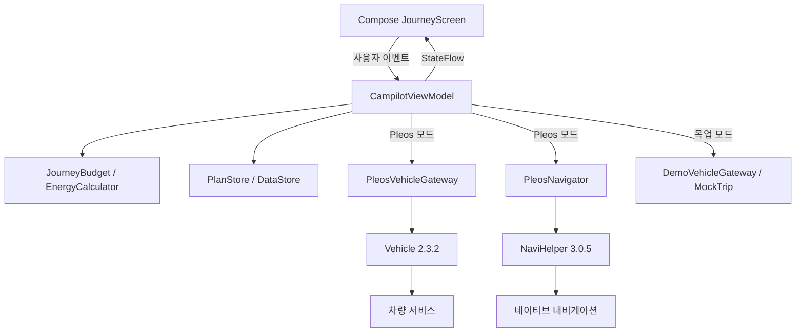

# Campilot — Pleos SDK 연결 및 전체 여정 프로토타입

> 이후 UI를 개편했습니다. 최신 화면·APK·버튼 이름은 [UI/UX 개선 보고서](Campilot_UIUX_개선_보고서.md)를 참고하세요. 아래 SDK 연결 검증 기록은 당시 버전 기준입니다.

작성: 2026-11-14  
대상: contest-application-consent.docx의 차박 비서 여정, 사용자 요청에 따라 장소·거리·소비 모델은 목업으로 구성.

## 1. 구현 결과

기존 가상 차량 프로토타입에 공식 Pleos SDK를 추가했다. 앱 시작 기본값은 **Pleos SDK 모드**이다. SDK 배터리 조회에 실패하면 차량 값 없음으로 표시하며 가짜 배터리로 대체하지 않는다.

**목업으로 새 여정**을 선택하면 배터리 35%에서 추천 → 전력 예산 → 충전소 경유 → 충전 → 차박 → 공조 관리 → 귀가 → 완료를 시연할 수 있다. 목업 모드는 실제 차량 명령을 보내지 않는다.

## 2. SDK와 기술 구성

| 항목 | 사용 버전 / 역할 |
|---|---|
| Pleos Vehicle | `ai.pleos.playground:Vehicle:2.3.2` — SOC, P단, 운전석 설정 온도, 온도 명령 및 재조회 |
| Pleos NaviHelper | `ai.pleos.playground:NaviHelper:3.0.5` — 목적지, 충전 경유지, 경로 상태 조회 |
| 공식 Maven | `https://nexus-playground.pleos.ai/repository/maven-releases/` — ai.pleos 그룹으로 저장소 범위 제한 |
| Android UI | Kotlin / Jetpack Compose Material 3 |
| 상태와 수명주기 | AndroidViewModel, StateFlow, viewModelScope, collectAsStateWithLifecycle |
| 설정 저장 | DataStore — 계획 입력값만 저장. 자동 공조 시작 상태는 복원하지 않음 |
| 검증 환경 | Pleos_Connect_v2.1.0, API 34, emulator-5554 |
| 빌드 | 프로젝트 기존 Gradle/AGP 구성 유지, compile/target SDK 37 |

Manifest: CAR_ENERGY, CAR_CLIMATE, CAR_DRIVE, CONTROL_CAR_CLIMATE, NAVI_ROUTE_SEARCH, NAVI_ROUTE. SDK 자체 Manifest의 서비스 검색 선언을 사용한다. SDK 의존성만 추가한 형태가 아니라 앱 코드가 Vehicle/NaviHelper를 생성하고 실제 서비스 IPC를 호출한다.

Gear API는 현재 SDK에서 deprecated 상태이지만 P단 확인에 사용 가능하다. 실패/null이면 실제 공조 제어를 허용하지 않는다.

## 3. 실제 연결과 목업 범위

| 기능 | 실제 SDK 모드 | 목업 모드 |
|---|---|---|
| 배터리 잔량 | SDK 관측 SOC | 가상 이동·체류·충전으로 변화 |
| 배터리 용량/전비 | 사용자 계획 가정 | 동일 |
| 캠핑장·집·충전소 | 목업 좌표·거리 한 세트 | 동일 |
| 추천 | 목업 후보 3곳 비교 | 동일 |
| 경로 전달 | NaviHelper로 네이티브 내비게이션 요청 | 화면 단계만 진행 |
| 도착 | 사용자의 도착 확인 + 최신 SOC/P단 | 시연 버튼 |
| 충전 | 실제 SOC가 목표 이상인지 확인. 충전 시작/종료 제어 없음 | 목표 잔량까지 충전 시연 |
| 설정 온도 | capability·허용 범위·P단 확인 후 SDK set 및 재조회 | 가상 명령 확인 |
| 냉난방 소비 | 계획 가정, 실측 소비가 아님 | 1.2kW 기본 가정 |
| 자동 공조 | 실측 소비 모델 확보 전 비활성화 | 과소비 시 0.5°C 조절, 0.12kW 절감 가정 |
| 차량 기본 캠핑 모드 | 앱에서 켜거나 끄지 않음 | 차량에서 별도 설정한다는 안내 |

**에뮬레이터 관측:** SOC 100%, P단 true를 실제 SDK로 읽었다. 운전석 HVAC_TEMPERATURE_SET은 PropertyNotAvailableException을 반환했다. 따라서 이 환경에서 온도 변경의 실제 성공은 검증되지 않았으며, UI에서 해당 기능을 비활성화한다. 실제 차량에서도 지원/권한/상태가 확인되어야 사용할 수 있다.

**내비게이션 관측:** 요청 후 네이티브 앱에서 ‘목업 경유 충전소’ 안내 화면을 확인했다. 반면 해당 환경의 상태 응답은 목적지 (0,0), 경유지 없음, isRouting=false였고 완료 이벤트가 오지 않았다. ‘요청 전송’과 ‘경로 확정’을 구분하며, 자동 확인이 안 되는 경우 사용자 확인 버튼을 제공한다. 요청 메서드 반환만으로 경로 성공을 표시하지 않는다.

## 4. 아키텍처

- domain/Journey.kt: 여정 단계, 목업 장소, 전체 에너지 예산, 실제 제어 사전 조건.
- vehicle/PleosVehicleGateway.kt: 연결·capability·조회·명령·타임아웃·해제. Mutex로 조회와 명령 직렬화.
- navigation/PleosNavigator.kt: 요청별 리스너, 목적지/경유지/안내 상태 확인, 확인되지 않은 요청의 별도 결과.
- ui/CampilotViewModel.kt: 여정 전이, 모드 분리, 제어 취소, 폴링과 타이머 수명주기.
- ui/JourneyScreen.kt: 불변 상태와 이벤트 콜백으로 화면 구성.
- MainActivity.kt: 테마, 계획 설정, 화면 수명주기 연결.

## 5. 작동 흐름

1. 차량 정보를 읽거나 명시적으로 목업 모드를 선택한다.
2. 목업 차박지 3곳 중 하나를 선택한다.
3. 이동 전력 + 체류 전력 + 종료 시 확보량을 계산한다.
4. 충분하면 바로 출발, 부족하면 충전소 경유를 요청한다.
5. SDK 경로 상태가 확인되면 이동 단계로 전환한다. 미확인 시 내비게이션에서 목적지/경유지를 확인한 후 사용자 확인으로 진행한다.
6. 충전소 도착 시 이미 이동한 거리를 제외해 목표 SOC를 다시 계산한다.
7. 목표 SOC 확인 후 캠핑장으로 이동한다.
8. 도착/P단 확인 후 차박 시작. 목업 자동 공조 또는 지원되는 SDK 수동 온도 요청을 사용한다.
9. 귀가 시작 시 귀가 전력과 예비 잔량을 확인하고 필요하면 충전 경유한다.
10. 귀가 확인 후 완료 화면을 표시한다.

실제 도착 감지, 자동 충전, 차량 기본 캠핑 모드 제어는 구현 범위에 포함하지 않는다. 앱 여정 초기화는 네이티브 내비게이션 안내를 종료하지 않으므로 안내 종료는 내비게이션에서 선택한다.

## 6. 계산 모델

- 이동 전력 = 거리(km) / 전비(km/kWh)
- 체류 전력 = 남은 시간(h) × 가정 평균 소비(kW)
- 종료 확보량 = max(용량 × 22%, 귀가 전력 + 용량 × 예비 잔량%)
- 필요 전력 = 남은 출발 이동 + 체류 + 종료 확보량
- 추가 충전 = max(0, 필요 전력 − 현재 전력)
- 목표 SOC는 100%로 잘라서 숨기지 않는다. 100% 초과 계획은 수정 안내를 표시한다.
- 충전소까지 도달할 전력이 없는 경우 출발을 차단한다.

22%는 사용자가 제공한 차량 캠핑 모드의 20% 종료 화면에 여유 2%를 더한 **고정 시연 정책**이다. Pleos 전체 차종의 공통 규칙으로 확정한 값이 아니다. 실제 외기온·일사량·단열·열펌프 효율·설정 온도별 소비 모델은 후속 실측 과제다.

## 7. 안전·오류 처리

- 관측값이 없거나 오래되었거나 P단이 아니면 실제 공조 제어 차단.
- SDK 범위·온도 간격 확인 후 명령하고 설정 온도를 재조회해 일치해야 완료 표시.
- SDK 모드에서는 온도를 바꿨다는 이유로 잔량이나 소비량을 임의 감소시키지 않음.
- 화면 비활성화 시 자동 제어와 진행 중 공조 작업 중지. 복귀해도 자동 제어는 재시작하지 않음.
- 네이티브 내비게이션 화면으로 전환될 때 경로 요청은 유지. 초기화/모드 변경 후 늦은 응답은 무효화.
- 앱 프로세스 종료 후 진행 중 여정은 복원하지 않음. 계획 입력만 복원.
- 앱 화면에서 관측/예상/목업/미지원 상태를 구분.

## 8. 검증 결과

최종 전체 검증: 2026-11-14, gradle-run 0012, 종료 코드 0.

| 검증 | 결과 |
|---|---|
| assembleDebug | 성공 |
| testDebugUnitTest | 19/19 통과, 건너뜀 없음 |
| connectedDebugAndroidTest | 21/21 통과, 건너뜀 없음 |
| lintDebug | 오류 0, 경고 34 |
| 실제 Vehicle IPC | 배터리 SOC/P단 관측 성공 |
| 실제 NaviHelper IPC | 요청 전송 성공, 경로 자동 확정은 미확인 |
| 실제 HVAC 작동 | 해당 에뮬레이터에서 미지원 응답, 성공 미검증 |

계측 테스트에는 전체 목업 여정, 충전 생략 경로, 화면 재생성, 좁은 화면/큰 글꼴, 자동 제어 중단, 실제 SDK 요청, 배경 전환, 늦은 경로 응답 취소가 포함된다. 실제 SDK 테스트는 Pleos 서비스가 설치된 에뮬레이터를 필요로 한다.

독립 최종 리뷰에서 발견한 목적지 변경 후 이전 경로 응답 문제를 회귀 테스트 실패로 재현한 뒤 수정했다. 귀가 충전소 도달 가능성도 같은 방식으로 검증했다. 두 회귀 테스트는 0011에서 실패하고 0012 전체 검증에서 통과했다. 귀가 경유 거리는 차박지→충전소와 충전소→집(5km)의 합이 homeKm이 되도록 통일했다.

남은 경고는 의존성 버전/버전 카탈로그, 백업 설정, 미사용 리소스 관련이다. 테스트/빌드를 막는 오류는 없으며, 이번 범위에서 불필요한 의존성 업그레이드는 진행하지 않았다.

**APK:** [Campilot-pleos-sdk-debug.apk](../artifacts/Campilot-pleos-sdk-debug.apk)  
**SHA-256:** `78CD5BB2540A883D36DBD4CC9750805F0D9561C3DB405D7441D6618B309C3215`

검증 보고서:
- [단위 테스트](../app/build/reports/tests/testDebugUnitTest/index.html)
- [에뮬레이터 테스트](../app/build/reports/androidTests/connected/debug/index.html)
- [Lint](../app/build/reports/lint-results-debug.html)
- [진행 기록 및 결정 사항](Campilot_Pleos_SDK_진행.md)

## 9. 시연 방법

**전체 흐름:** 실행 → 목업으로 새 여정 → 첫 차박지 ‘이곳 선택’ → 충전소 경유 출발 → 충전소 도착 시연 → 목표까지 충전 시연 → 캠핑장으로 출발 → 도착·주차 시연 → 자동 공조 시작 → 과소비 시연 → 즉시 중지 → 귀가 시작 → 집 도착 시연.

**SDK 확인:** 기본 SDK 모드에서 SOC/P단/설정 온도 지원 상태 확인 → 장소 선택 → 출발 → 네이티브 내비게이션 경로 확인 → Campilot로 복귀 → 자동 확인되지 않은 경우 ‘내비게이션에서 경로를 확인했어요’. 좌표는 시연용이므로 실제 운행용으로 사용하지 않는다.

## 10. 후속 작업

- 실제 차종에서 HVAC 읽기/쓰기, 권한, 허용 온도 범위 검증.
- 냉난방 실측 전력과 외기 조건 기반 모델 확보 후 실제 자동 관리 적용.
- 실 GPS, 합법적 차박 장소 데이터, 충전소 가용성, 실제 경로 거리 연동.
- 밤샘 백그라운드 모니터링/재연결/프로세스 복구 및 차량 UX 제한 검증.
- 공모전 제출용 디자인·서명·스토어 심사 규칙 최종 확인.

## 공식 근거

- [Vehicle SDK](https://document.pleos.ai/docs/pleos-only/connect-sdk-pleos/Vehicle/intro)
- [차량 capability 확인](https://document.pleos.ai/docs/pleos-only/connect-sdk-pleos/Vehicle/check-capability)
- [NaviHelper SDK](https://document.pleos.ai/docs/pleos-only/connect-sdk-pleos/NaviHelper/intro)
- [경유지 경로 요청](https://document.pleos.ai/docs/pleos-only/connect-sdk-pleos/NaviHelper/route-with-waypoints)
- [내비게이션 이벤트](https://document.pleos.ai/docs/pleos-only/connect-sdk-pleos/NaviHelper/event-listeners)
- [프로젝트 생성과 SDK 지원 범위](https://document.pleos.ai/docs/pleos-only/create-my-project)
