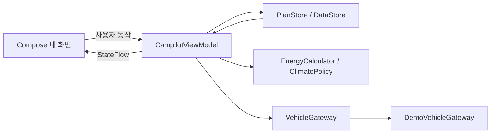

# Campilot 프로토타입 구현 보고서

- 작성일: 2026-11-12
- 버전: 0.1.0 / package com.example.campilot
- 결과: 네 기능을 연결한 가상 차량 기반 Android 프로토타입 구현 및 자동 검증 완료
- [실행 APK](../artifacts/Campilot-prototype-debug.apk), [시연 가이드](Campilot_시연_가이드.md)
- APK SHA256: 5B4EC47D0C35D6179C887D197755AAC03BBE0613E18C569F951430657116FFDD

## 1. 구현 범위

| 기능 | 구현 내용 | 데이터 범위 |
|---|---|---|
| 목적지 추천 | 가상 캠핑장 3곳, 계획 충족 여부 우선·거리순·ID순 정렬 | 가상 출발 위치·경로 거리·시설·숙박 허용 |
| 예상 전력 계산 | 이동·체류·다음 이동·예비분, 추가 충전·목표 SOC·도착 가능성·계획 실현 가능성 | 사용자 입력 및 명시된 가상 소비 모델 |
| 공조 자동 제어 | 명시적 시작·중지, 난방 하향/냉방 상향, 0.5도 단위, 허용 범위, 적용 확인/실패 | 가상 차량 명령, 실제 공조 제어 없음 |
| 에너지 관리 | 가속 시간 소비, 예상 잔량 범위, 과소비·오류 시나리오, 잔량 추세 | 가상 관측값 및 추정값 |

계획·캠핑장·전력 예산·차박 대시보드 화면을 하단 탭과 단계 이동으로 연결했다. 모든 화면에 시연 모드 및 데이터 구분을 표시한다. 주간·야간 테마 전환과 넓은 대시보드의 두 열/좁은 화면의 세로 배치를 제공한다.

## 2. 사용 SDK·라이브러리

직접 선언한 의존성 기준이다. Compose BOM은 Compose 하위 라이브러리 버전을 정렬한다.

| 구성 | 버전 | 용도 |
|---|---|---|
| Android Gradle Plugin | 9.5.1 | 앱 빌드, 내장 Kotlin 지원 |
| Compose compiler plugin | 2.4.10 | Compose 컴파일 |
| Compose BOM | 2026.09.00 | Compose UI·Material 3·테스트 버전 정렬 |
| Activity Compose | 1.12.4 | ComponentActivity와 Compose 연결 |
| Lifecycle ViewModel/Runtime Compose | 2.10.0 | 화면 상태·수명주기 구독 |
| DataStore Preferences | 1.2.0 | 계획 입력값 로컬 저장 |
| Navigation 3 UI | 1.0.1 | NavDisplay 및 화면 엔트리 |
| AppCompat / Material | 1.6.1 / 1.10.0 | 기존 XML 시작 테마 |
| JUnit | 4.13.2 | 계산·정책 단위 테스트 |
| AndroidX Test JUnit / Runner | 1.3.0 / 1.7.0 | 에뮬레이터 계측 테스트 |
| Compose UI Test | BOM 정렬 | 화면 흐름·입력·복원·좁은 배치 |
| Coroutines Test | 1.10.2 | 테스트 의존성. 현재 핵심 비동기 안전 테스트는 계측 환경에서 실행 |

compileSdk/targetSdk 37, minSdk 28. 실행 검증은 Pleos의 Android 14(API34) 시스템 이미지에서 수행했다. 최신 라이브러리로 전면 업그레이드하지 않고 통과한 조합을 고정했다.

**Pleos Vehicle/FusedLocation/NaviHelper SDK는 이번 APK에 포함하지 않았다.** 기존 기획에 따른 1차 모의 시연 범위다. 실제 위치·실차 SOC·공조·내비게이션·CarUxRestrictions를 읽거나 명령하지 않는다. Pleos 에뮬레이터에서 실행했다는 사실과 Pleos 차량 SDK를 연동했다는 사실을 구분한다. 위치·차량 권한을 선언하지 않았으며 서버·계정·API 키가 필요하지 않다.

기술 선택 참고: [Compose BOM](https://developer.android.com/develop/ui/compose/bom), [Compose compiler 설정](https://developer.android.com/develop/ui/compose/setup-compose-dependencies-and-compiler), [Navigation 3 릴리스](https://developer.android.com/jetpack/androidx/releases/navigation3), [AGP 내장 Kotlin](https://developer.android.com/build/migrate-to-built-in-kotlin).

## 3. 아키텍처

단일 app 모듈의 ViewModel 중심 단방향 상태 흐름이다. 사용자 입력으로 상태가 갱신되면 계산 결과와 화면을 다시 표시한다.

| 소스 | 책임 |
|---|---|
| app/src/main/java/com/example/campilot/MainActivity.kt | 실행·Back·테마·Navigation 3·상태 기반 화면 |
| domain/CampModels.kt | 계획, 캠핑장, 단계, 계산 결과 |
| domain/EnergyCalculator.kt | 순수 계산·추천 정렬·공조 조절 정책 |
| vehicle/VehicleGateway.kt | 차량 인터페이스, 관측 모델, 결과 타입, 가상 명령 |
| data/PlanStore.kt | 계획 저장·불러오기 |
| ui/CampilotViewModel.kt | 세션, 가상 시계, 비동기 명령, 제어 중단, 화면 상태 |

위 표의 축약 경로는 app/src/main/java/com/example/campilot/ 아래다. Activity는 ViewModel의 StateFlow를 collectAsStateWithLifecycle로 구독한다. 화면은 상태와 콜백을 받으며, 차량 명령은 viewModelScope의 취소 가능한 작업이 소유한다.

프로토타입 규모에 맞춰 계획의 여러 소형 파일을 묶었다. 별도 DI 프레임워크나 다중 모듈을 도입하지 않았으며 화면 컴포넌트는 MainActivity.kt에 함께 있다. 실제 기능 확장 시 화면별 분리를 권장한다.

## 4. 작동 흐름

1. 앱 시작 시 DataStore에서 계획을 읽는다. 진행 세션·자동 제어는 저장하지 않는다.
2. 숫자 입력은 유한값·범위·온도 순서를 확인한다. 빈 입력/비정상 값으로 진행하지 못한다.
3. 가상 캠핑장마다 동일한 계산 계약을 적용하고 적합한 후보부터 정렬한다.
4. 전력 예산에서 이동·체류·다음 이동·예비분과 충전량을 표시한다.
5. 차박 시작 시 캠핑장까지 이동 에너지를 한 번만 차감한다.
6. 2초마다 가상1분을 진행하며 남은 체류와 현재 에너지로 재계산한다.
7. 자동 공조를 켠 상태에서 부족이 예상되면 허용 범위 안에서 설정을 변경한다.
8. 명령 확인 후에만 온도와 가상 소비 감소를 반영한다. 중지·수동 변경·오류 시 작업을 취소한다.
9. 다른 캠핑장을 선택하면 기존 체류를 초기화하고 이동 예산부터 다시 시작한다.
10. 비활성화 시 자동 제어와 타이머를 중지한다. 복귀하면 시간 진행은 재개하되 자동 공조는 사용자가 켠다.

## 5. 계산과 제어

- 이동 kWh = 거리 km / 전비 km/kWh.
- 체류 kWh = 남은 시간 × 총 평균 전력.
- 추가 충전 = max(0, 이동 + 체류 + 다음 이동 + 예비 − 현재 에너지).
- 도착 후에는 이동 에너지를 다시 차감하지 않는다.
- 소비 범위는 총소비의80~100%로 둔 시연 가정이다. 상한 소비로 부족 여부를 판단한다.
- 전체 요구 에너지가 용량을 넘으면 목표SOC를100%로 잘라 정상으로 표시하지 않는다.
- 에너지 부족을 표현하는 음수 예상치는 실제 잔량과 구분하는 문구를 제공한다.
- 기본60kWh/60%/8h, 솔숲20km에서 과소비3.0kW를 적용하면 부족 예측과 자동 조절이 재현된다.
- 난방은0.5도 하향, 냉방은0.5도 상향. 조절 간격은 가상60초 이상, 온도 변경1회당 소비0.12kW 감소를 가정한다.
- 자동 공조 끄기나 사용자 허용 범위 초과 명령은 하지 않는다.
- 명령500ms 확인 지연, 확인/거절/타임아웃 결과 타입을 제공한다. 기본 오류 버튼은 거절을 재현한다.
- 세대 번호와 Job 취소로 중지 이후 늦은 응답이 상태를 다시 활성화하지 못하게 한다.
- 가상 관측의 연결·권한·주차·timestamp(10초 기준)를 확인한다. 오류 버튼이 가상 상태를 주입하며, 실제 SDK 이벤트 감시는 후속 작업이다.
- 이번 정책은 부족 시 단방향 절약 조절이다. 계획의0.5kWh 회복 히스테리시스는 별도로 구현하지 않았다.

## 6. 검증 결과

검증 환경: Windows / Gradle9.6.0 / Pleos Connect v2.1.0, x86_64, Android14. AVD는 별도 창으로 실행했다.

| 항목 | 결과 |
|---|---|
| assembleDebug | 성공 |
| testDebugUnitTest | 12개 통과, 실패0 |
| connectedDebugAndroidTest | 13개 통과, 실패0, 건너뜀0 |
| lintDebug | 성공, 오류0 / 경고32 |
| Pleos 설치·실행 | 성공 |
| 기본 네 화면 및 자동 공조 변경 | 화면 직접 확인 |
| 400dp·글자150% | Compose 계측 테스트에서 시작·초기화 조작 접근 통과 |
| 실제 차량·밤샘 동작 | 이번 범위 아님 |

단위 테스트12개 중1개는 기존 기본 테스트다. 계측13개 중1개도 기존 기본 테스트다. 사용자 기능 검증은 계산/정책11개와 UI/제어/레이아웃12개다.

주요 검증:
- 고정 계산 예시 추가충전0.6kWh, 목표SOC51%, 종료10.4kWh.
- 예비 경계·체류 증가·도착 후 이중 차감 방지·총소비 중복 합산 방지.
- NaN·무한대·용량0·범위 밖 SOC·실현 불가능 계획.
- 난방/냉방 방향과 온도 경계.
- 계획→추천→예산→대시보드 흐름과 빈 입력 차단, Activity 재생성.
- 자동 제어 중지 시 pending 명령 취소, 수동 변경, 명령 거절.
- 연결 해제·주행·권한·오래된 값과 백그라운드 전환.
- 기본 과소비의 적용 완료, 캠핑장 변경 초기화, 새 세션 자동 제어Off.

검증 명령은 gradle-run 래퍼를 통해 실행했다. 주요 최종 질문 “Does the final APK pass unit UI safety regression tests and lint?”에 종료0, “Does 400dp layout with 150 percent font preserve essential controls?”에도 종료0을 확인했다. 초기 미구현 테스트는 컴파일 실패했고 구현 이후 통과했다. 추가 제어 테스트의2건 실패는 저장 계획을 공유하는 테스트의 초기조건 누락을 수정해 해결했다.

결과 원본:
- app/build/reports/tests/testDebugUnitTest/index.html
- app/build/reports/androidTests/connected/debug/index.html
- app/build/reports/lint-results-debug.html

린트 경고는 의존성 최신 버전 안내, 버전 카탈로그 사용, 기존 미사용 리소스, 백업 설정 관련이다. Compose test v1 API 사용 중단 권고와 빌드 도구의 Unsafe 경고도 남아 있다. 경고0을 주장하지 않는다.

## 7. 코드 리뷰 및 계획 조정

독립 읽기 전용 리뷰에서 지적한 항목을 수정했다.

1. 과소비2.4kW로는 기본 시연에서 부족이 발생하지 않아3.0kW로 조정하고 확인 테스트를 추가했다.
2. 프로세스 복원 시 체류 없는 대시보드를 열지 않도록 경로를 검사한다.
3. 체류 중 캠핑장을 바꾸면 세션을 초기화한다.
4. 가상 관측 필드의 연결·권한·주차·신선도를 제어 전에 검사한다.

Git 저장소가 없는 작업 공간이므로 worktree·커밋 단계는 수행하지 않았다. 원본 계획의 파일 구성은 역할별6개 소스 파일로 축약했다. Android ViewModel을 사용하며 DataStore 복구 실패는 기본 계획과 안내로 처리한다.

## 8. 한계와 다음 개발 단계

- 실제 GPS·경로·캠핑장 API·기상·차량 SDK·음성·지도는 미연동이다.
- 실제 주행 제한 이벤트는 연결하지 않았다. 현재 주차 중심 가상 시연이며 실제 배포용 주행 정책 준수 검증을 완료한 앱이 아니다.
- 야간/주간은 수동 전환이다. 차량 조명 상태 자동 연동은 후속이다.
- 실측 배터리 정확도·온도별 소비 절감·CPU/RAM 기준·밤샘 Suspend는 검증하지 않았다.
- Pleos 기본 창의 화면은 확인했다. adb 강제 task resize 실험에서 플랫폼 표면 위치와 bounds가 어긋나는 현상이 있어 전체 폼팩터 호환 완료로 판단하지 않았다. 해당 실험을 복원하고 앱을 다시 실행했다.
- 공식 FormFactorConsole의 전체 차량 디스플레이·CCP·IME 매트릭스는 후속 검증이 필요하다. 400dp 테스트를 전체 플랫폼 전환 검증과 동일시하지 않는다.
- 보고서의 캡처 영상은 개발 검수용 짧은 영상이다. 발표용90초 녹화는 가이드대로 별도 편집할 수 있다.
- 최종 APK는 debug 서명이며 App Market 출시용 제출물은 아니다.

다음 순서는 Pleos 차량별 capability/승인 권한 확인 → 실제 VehicleGateway 구현 → FusedLocation/경로/캠핑장 데이터 → 주행 제한·CCP·IME 통합 → 실제 소비 보정 → 차박 전원 모드 검증이다.
